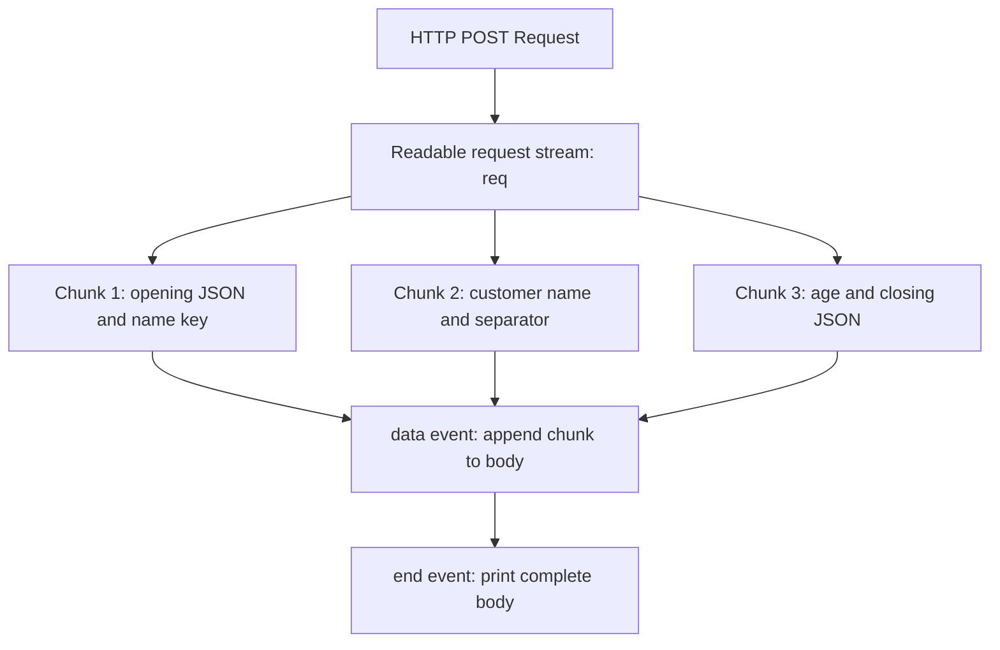
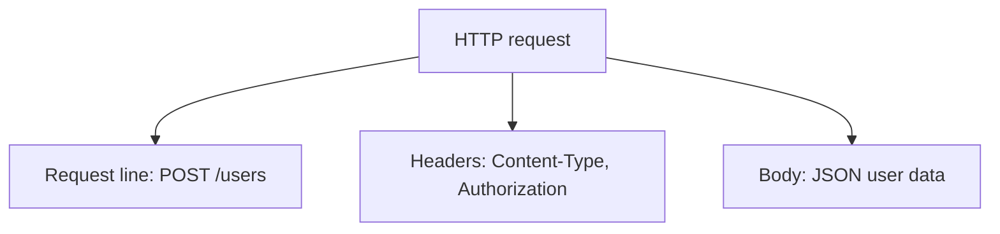
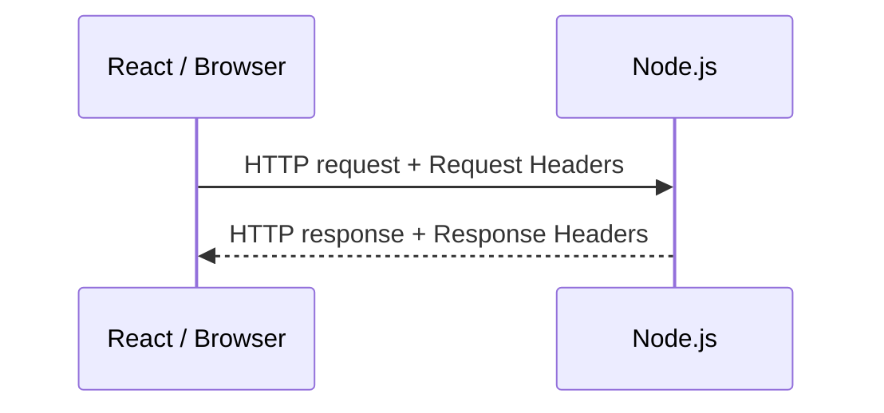
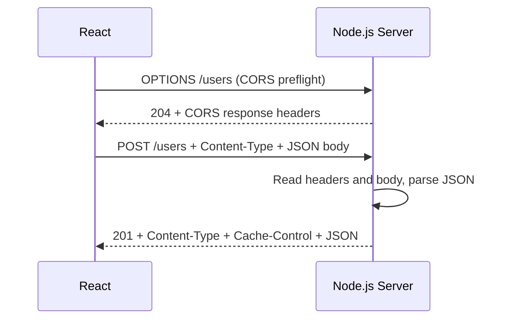

# Lesson 28 — http

## Deep Dive — Kya req.on("data") aur req.on("end") Events Hain?

**Haan!** Ye Node.js ke real-world **EventEmitter + Readable Stream** ka example hai. Is section mein har line, output aur event flow ko samjhenge.

### 1. Sabse pehle code samjho

```js
let body = "";

req.on("data", (chunk) => {
  body += chunk;
});

req.on("end", () => {
  console.log(body);
});
```

- **req**: HTTP request object, jo **Readable Stream** bhi hai.
- **on()**: Event listener register karta hai.
- **data**: Jab request body ka chunk read hone ke liye available hota hai, tab event fire hota hai.
- **end**: Jab stream ka saara data read ho chuka ho, tab event fire hota hai.

### 2. Real-life POST Request Example

Maan lo React frontend se POST request bhejte ho:

```js
fetch("http://localhost:3000/users", {
  method: "POST",
  headers: {
    "Content-Type": "application/json",
  },
  body: JSON.stringify({
    name: "Vikash",
    age: 25,
  }),
});
```

Frontend se logically ye JSON send hota hai:

```json
{
  "name": "Vikash",
  "age": 25
}
```

Node.js request body ko stream ki tarah read karta hai. Data **ek ya multiple chunks** mein aa sakta hai.

**Illustrative graphics — 3 chunks (actual chunks alag ho sakte hain):**



Ye Mermaid flowchart GitHub par render hona chahiye. Chunk labels ko readable rakha hai; exact JSON fragments niche ke code aur output examples mein diye gaye hain.

**Same flow in plain-text form (fallback/reference):**

```text
HTTP POST request
        |
        v
req (Readable Stream)
        |
        +-- chunk 1 --> data event --> body += chunk
        +-- chunk 2 --> data event --> body += chunk
        +-- chunk 3 --> data event --> body += chunk
        |
        +-- stream finished --> end event --> console.log(body)
```

**Important:** Network/stream buffering ki wajah se exactly 3 chunks milna guaranteed nahi hai. Ek chunk bhi aa sakta hai, ya bahut saare.

### 3. Step-by-step Execution with Output

```js
let body = "";

req.on("data", (chunk) => {
  body += chunk;
});
```

Har `data` event ke saath next chunk listener ko milta hai. Maan lo chunks aise mile:

```text
First data event:
chunk = '{"name":'
body  = '{"name":'

Second data event:
chunk = '"Vikash",'
body  = '{"name":"Vikash",'

Third data event:
chunk = '"age":25}'
body  = '{"name":"Vikash","age":25}'
```

Jab stream successfully finish hoti hai:

```js
req.on("end", () => {
  console.log(body);
});
```

**Output:**

```text
{"name":"Vikash","age":25}
```

### 4. data aur end Event Emit Kaun Karta Hai?

Pichhle EventEmitter lesson mein humne manually event trigger kiya:

```js
emitter.emit("greet");
```

Lekin HTTP example mein hum sirf listeners likhte hain:

```js
req.on("data", callback);
req.on("end", callback);
```

**Node.js ka internal stream system ye events emit karta hai.** `req` ek `http.IncomingMessage` object hai jo `Readable` stream extend karta hai. Readable streams EventEmitter se functionality inherit karti hain.

| Custom EventEmitter | HTTP Request Stream |
| --- | --- |
| Hum event name choose karte hain | Node.js built-in stream events provide karta hai |
| Hum `emit()` call karte hain | Stream internally events emit karti hai |
| Hum `on()` se listen karte hain | Hum `req.on()` se listen karte hain |

### 5. Complete Working HTTP Server Example

**server.js**

```js
import http from "node:http";

const server = http.createServer((req, res) => {
  if (req.method === "POST" && req.url === "/users") {
    let body = "";

    req.on("data", (chunk) => {
      console.log("Data event fired");
      body += chunk;
    });

    req.on("end", () => {
      console.log("End event fired");

      let user;
      try {
        user = JSON.parse(body);
      } catch {
        res.writeHead(400, { "Content-Type": "text/plain" });
        return res.end("Invalid JSON");
      }

      console.log("User:", user);

      res.writeHead(201, {
        "Content-Type": "application/json",
      });

      res.end(JSON.stringify({
        success: true,
        user,
      }));
    });

    req.on("error", (error) => {
      console.error("Request stream error:", error);
      if (!res.headersSent) {
        res.writeHead(400);
      }
      if (!res.writableEnded) res.end("Request failed");
    });

    return;
  }

  res.writeHead(404);
  res.end("Not found");
});

server.listen(3000, () => {
  console.log("Server running on port 3000");
});
```

Run:

```bash
node server.js
```

Then frontend `fetch()` example run karo, ya terminal mein:

```bash
curl -X POST http://localhost:3000/users \
  -H "Content-Type: application/json" \
  -d '{"name":"Vikash","age":25}'
```

**Possible terminal output (agar body ek chunk mein aayi):**

```text
Server running on port 3000
Data event fired
End event fired
User: { name: 'Vikash', age: 25 }
```

**HTTP response body:**

```json
{
  "success": true,
  "user": {
    "name": "Vikash",
    "age": 25
  }
}
```

**Production note:** Ye learning example hai. Production mein request body size limit, invalid JSON, aborted requests aur response lifecycle ko robustly handle karna zaroori hai. Unlimited body accumulation memory exhaust kar sakta hai.

### 6. data vs end — Important Difference

| `data` event | `end` event |
| --- | --- |
| Chunk available hone par fire hota hai | Readable stream successfully finish hone par fire hota hai |
| Zero, one ya multiple times ho sakta hai | Normal successful completion par once hota hai |
| Callback ko chunk milta hai | Batata hai ki aur data nahi aayega |

Agar stream prematurely destroy/fail ho, `end` event aana guaranteed nahi hai.

### 7. Interview Question

**Q: Why do we use `req.on("data")` and `req.on("end")` in Node.js?**

Because an HTTP request is a readable stream. The `data` event lets us receive chunks of incoming request-body data, and the `end` event tells us the stream has finished providing data.

**Ek line mein yaad rakho:**

- `req.on("data")` = **Jab bhi data aaye, mujhe do.**
- `req.on("end")` = **Jab poora data aa jaye, mujhe batao.**

### 8. Express Mein Ye Manually Kyun Nahi Karte?

Express mein `express.json()` middleware request body ko read aur JSON parse karne ka kaam karta hai:

```js
import express from "express";

const app = express();

app.use(express.json());

app.post("/users", (req, res) => {
  console.log(req.body);
  res.status(201).json({ success: true, user: req.body });
});

app.listen(3000);
```

Isliye Express controller mein normally manually `req.on("data")` / `req.on("end")` likhne ki zaroorat nahi hoti. Express ke neeche wahi Node.js HTTP request stream hoti hai.

---

## Why Learn node:http?

Frameworks such as Express hide many details.

Learning `node:http` shows what actually happens underneath.

Import:

```js
import http from "node:http";
```

## Create a Server

```js
const server = http.createServer((req, res) => {
  res.end("Hello Node.js");
});

server.listen(3000);
```

Flow:

```text
Client
  |
  v
TCP/HTTP request
  |
  v
Node HTTP server
  |
  v
request handler
  |
  v
response
```

## Request Object

`req` contains information such as:

```js
req.method
req.url
req.headers
```

Example:

```js
console.log(req.method);
console.log(req.url);
console.log(req.headers);
```

## Response Object

Set status:

```js
res.statusCode = 200;
```

Set header:

```js
res.setHeader(
  "Content-Type",
  "application/json"
);
```

Send:

```js
res.end(JSON.stringify({
  success: true,
}));
```

## Basic Routing

```js
const server = http.createServer((req, res) => {
  if (
    req.method === "GET" &&
    req.url === "/health"
  ) {
    res.writeHead(200, {
      "Content-Type": "application/json",
    });

    return res.end(
      JSON.stringify({ status: "ok" })
    );
  }

  res.statusCode = 404;
  res.end("Not Found");
});
```

## Request Body Is a Stream

This is important.

`req` is a readable stream.

```js
let body = "";

req.on("data", (chunk) => {
  body += chunk;
});

req.on("end", () => {
  console.log(body);
});
```

For production code, body-size limits matter. Never accept unlimited request bodies.

## Parse JSON

```js
let body = "";

req.on("data", (chunk) => {
  body += chunk;
});

req.on("end", () => {
  try {
    const data = JSON.parse(body);
    console.log(data);
  } catch {
    res.statusCode = 400;
    return res.end("Invalid JSON");
  }
});
```

## Status Codes

Common examples:

```text
200 OK
201 Created
204 No Content
400 Bad Request
401 Unauthorized
403 Forbidden
404 Not Found
409 Conflict
422 Unprocessable Content
500 Internal Server Error
```

## Headers — Complete Guide (Basic to Advanced)

HTTP headers samajhna Node.js, Express, React aur REST APIs ke liye important hai.

### 1. HTTP Header Kya Hota Hai?

**Headers additional information (metadata)** hain jo client aur server HTTP request/response ke saath exchange karte hain. Ye batate hain ki body ka format kya hai, authentication kaise pass ho rahi hai, cache policy kya hai, etc.

Example (React):

```js
fetch("http://localhost:3000/users", {
  method: "POST",
  headers: { "Content-Type": "application/json" },
  body: JSON.stringify({ name: "Vikash", age: 25 }),
});
```

`Content-Type: application/json` server ko batata hai ki body JSON format mein hai. **Header JSON conversion nahi karta**; `JSON.stringify()` karta hai.

### 2. HTTP Request Ka Structure

HTTP/1.1 request ko conceptually aise samjho:

```http
POST /users HTTP/1.1
Host: localhost:3000
Content-Type: application/json
Authorization: Bearer token123

{"name":"Vikash","age":25}
```

1. **Request line**: Method, path aur HTTP version.
2. **Headers**: Request ki metadata (e.g. Content-Type, Authorization).
3. **Empty line**: Headers aur body separate karti hai.
4. **Body**: Actual user data.

**Graphics — request ke parts:**



Ye HTTP/1.1 ka readable representation hai; HTTP/2 aur HTTP/3 ka wire format different hota hai.

### 3. Request Headers vs Response Headers



| Request headers | Response headers |
| --- | --- |
| Client server ko bhejta hai | Server client ko bhejta hai |
| Request processing ki information | Response handling ki information |
| `Authorization`, `Accept`, `Cookie` | `Set-Cookie`, `Cache-Control`, `Content-Security-Policy` |

`Content-Type` aur `Content-Encoding` jaise headers dono directions mein use ho sakte hain.

### 4. Important Request Headers

#### A. Content-Type — Main Kya Bhej Raha Hoon?

```js
fetch("/api/users", {
  method: "POST",
  headers: { "Content-Type": "application/json" },
  body: JSON.stringify({ name: "Vikash" }),
});
```

| Value | Body ka format |
| --- | --- |
| `application/json` | JSON |
| `text/plain` | Plain text |
| `application/x-www-form-urlencoded` | URL-encoded form |
| `multipart/form-data` | File uploads + form fields |
| `application/xml` | XML |

**Note:** `FormData` ko browser `fetch` se bhejte waqt manually `multipart/form-data` set mat karo; browser boundary ke saath sahi header set karta hai.

#### B. Accept — Mujhe Kis Format Mein Response Chahiye?

```js
fetch("/api/users", {
  headers: { Accept: "application/json" },
});
```

- **Content-Type** = Main kya bhej raha hoon?
- **Accept** = Mujhe kis format mein response chahiye?

Server content negotiation support karta ho toh preference consider kar sakta hai; `Accept` bhejne se JSON response guaranteed nahi hota.

#### C. Authorization — Protected API Credentials

```js
fetch("/api/profile", {
  headers: {
    Authorization: `Bearer \${accessToken}`,
  },
});
```

Node.js:

```js
const authHeader = req.headers.authorization;
console.log(authHeader); // Bearer eyJhbGciOi...
```

Common cases: JWT, OAuth bearer tokens, Basic auth. **HTTPS, token validation, expiry aur authorization checks** bhi required hain. Real access tokens ko logs mein print na karo.

#### D. Cookie — Browser Se Server

HTTP request:

```http
GET /profile HTTP/1.1
Host: example.com
Cookie: sessionId=abc123
```

Browser stored cookies ko applicable requests par automatically attach kar sakta hai. Frontend JavaScript manually `Cookie` request header set nahi kar sakta. Cross-origin `fetch` mein cookie behavior ke liye credentials/CORS rules bhi matter karte hain.

#### E. Origin — Request Kis Origin Se Aayi?

```http
Origin: http://localhost:5173
```

Example: React `http://localhost:5173`, Node `http://localhost:3000`. Ports different hone se origins different hain. Browser cross-origin access par CORS enforce karta hai. `Origin` header har request par zaroori nahi hota.

#### F. User-Agent — Client Ki Information

```http
User-Agent: Mozilla/5.0 ...
```

Analytics/compatibility ke liye useful, lekin spoof ho sakta hai: authentication ka reliable proof nahi.

### 5. Important Response Headers

Example:

```http
HTTP/1.1 200 OK
Content-Type: application/json
Cache-Control: no-store

{"success":true,"name":"Vikash"}
```

#### A. Content-Type — Response Body Ka Format

```js
res.setHeader("Content-Type", "application/json");
res.end(JSON.stringify({ success: true }));
```

#### B. Set-Cookie — Browser Ko Cookie Store Karne Ki Instruction

```js
res.setHeader(
  "Set-Cookie",
  "sessionId=abc123; HttpOnly; Secure; SameSite=Lax; Path=/"
);
```

- `HttpOnly`: JavaScript access restrict karta hai.
- `Secure`: HTTPS par send hoti hai (localhost exceptions possible).
- `SameSite=Lax`: Kuch cross-site sending restrict karta hai.
- `Path=/`: Cookie ka path scope.

Real session IDs unpredictable aur server-validated hone chahiye. `HttpOnly` CSRF se complete protection nahi deta.

#### C. Cache-Control — Caching Policy

```js
res.setHeader("Cache-Control", "no-store");
```

| Directive | Meaning |
| --- | --- |
| `no-store` | Response store na karo |
| `no-cache` | Reuse se pehle validate karo |
| `public` | Shared caches bhi store kar sakte hain |
| `private` | Shared cache store na kare |
| `max-age=3600` | Response 3600 seconds tak fresh ho sakta hai |

Example: Public product listing caching ke liye suitable ho sakti hai; sensitive account data ke liye `no-store` useful hai.

#### D. CORS Response Headers

```http
Access-Control-Allow-Origin: http://localhost:5173
Access-Control-Allow-Methods: GET, POST
Access-Control-Allow-Headers: Content-Type, Authorization
```

Browser ko batate hain ki kaunse cross-origin accesses allowed hain. Credentials ke saath wildcard `*` origin use nahi kar sakte. CORS browser enforcement hai, server-side authorization ka replacement nahi.

#### E. Security Headers

| Header | Purpose |
| --- | --- |
| `Content-Security-Policy` | Resource loading restrict |
| `Strict-Transport-Security` | HTTPS policy |
| `X-Content-Type-Options` | MIME sniffing restrict |
| `Referrer-Policy` | Referrer information control |
| `Permissions-Policy` | Browser feature permissions |

Express apps mein `helmet` middleware commonly security headers configure karta hai.

### 6. Node.js Mein Request Headers Read Karna

```js
import http from "node:http";

const server = http.createServer((req, res) => {
  console.log("All headers:", req.headers);
  console.log("Content-Type:", req.headers["content-type"]);
  console.log("Authorization present:", Boolean(req.headers.authorization));
  res.end("Headers received");
});

server.listen(3000, () => {
  console.log("Server running on port 3000");
});
```

Node.js `req.headers` mein header names generally lowercase normalize karta hai:

```js
req.headers["content-type"]; // correct
req.headers["Content-Type"]; // usually undefined
```

### 7. Node.js Mein Response Headers Set Karna

**Method 1 — setHeader():**

```js
res.statusCode = 200;
res.setHeader("Content-Type", "application/json");
res.setHeader("Cache-Control", "no-store");
res.end(JSON.stringify({ success: true }));
```

**Method 2 — writeHead():**

```js
res.writeHead(200, {
  "Content-Type": "application/json",
  "Cache-Control": "no-store",
});
res.end(JSON.stringify({ success: true }));
```

`setHeader()` header set/modify karta hai; `writeHead()` status aur headers specify karke headers send karna initiate karta hai. Headers send hone ke baad unhe normally change nahi kar sakte.

### 8. Complete Practical Example — React + Node.js

**Backend: server.js**

```js
import http from "node:http";

const server = http.createServer((req, res) => {
  if (req.method === "POST" && req.url === "/users") {
    console.log("Content-Type:", req.headers["content-type"]);

    let body = "";

    req.on("data", (chunk) => {
      body += chunk;
    });

    req.on("end", () => {
      let user;
      try {
        user = JSON.parse(body);
      } catch {
        res.writeHead(400, {
          "Content-Type": "application/json",
          "Access-Control-Allow-Origin": "http://localhost:5173",
        });
        return res.end(JSON.stringify({ error: "Invalid JSON" }));
      }

      res.writeHead(201, {
        "Content-Type": "application/json",
        "Cache-Control": "no-store",
        "Access-Control-Allow-Origin": "http://localhost:5173",
      });

      res.end(JSON.stringify({
        success: true,
        data: user,
      }));
    });

    req.on("error", (error) => {
      console.error("Request error:", error);
      if (!res.headersSent) res.writeHead(400);
      if (!res.writableEnded) res.end("Request failed");
    });

    return;
  }

  // Browser preflight for cross-origin JSON POST
  if (req.method === "OPTIONS" && req.url === "/users") {
    res.writeHead(204, {
      "Access-Control-Allow-Origin": "http://localhost:5173",
      "Access-Control-Allow-Methods": "POST, OPTIONS",
      "Access-Control-Allow-Headers": "Content-Type",
    });
    return res.end();
  }

  res.writeHead(404);
  res.end("Not Found");
});

server.listen(3000, () => {
  console.log("Server running on port 3000");
});
```

**Frontend:**

```js
async function createUser() {
  const response = await fetch("http://localhost:3000/users", {
    method: "POST",
    headers: {
      "Content-Type": "application/json",
      Accept: "application/json",
    },
    body: JSON.stringify({ name: "Vikash", age: 25 }),
  });

  const data = await response.json();
  console.log(data);
}

createUser();
```

**Expected response body:**

```json
{
  "success": true,
  "data": { "name": "Vikash", "age": 25 }
}
```

**Flow graphics:**



Production mein request size limits, aborted connections, robust validation aur stricter CORS policies bhi handle karo.

### 9. HTTP Headers Ke Benefits

1. **Content handling:** Body format communicate hota hai.
2. **Authentication:** Credentials/token pass kiye ja sakte hain.
3. **Caching:** Network requests aur server load reduce ho sakta hai.
4. **Security:** Browser behavior aur resource loading restrictions.
5. **CORS:** Browser cross-origin access rules.
6. **Content negotiation:** Preferred formats/languages.
7. **Performance:** Compression aur cache policies communicate hoti hain.

### 10. Important Header Differences — Interview Table

| Header | Simple meaning |
| --- | --- |
| `Content-Type` | Body ka media type |
| `Accept` | Preferred response media type |
| `Authorization` | Client credentials |
| `Cookie` | Client → server cookies |
| `Set-Cookie` | Server → client cookie instructions |
| `Origin` | Request initiating origin |
| `Cache-Control` | Caching behavior |
| `Content-Encoding` | Applied compression/encoding |
| `Accept-Encoding` | Supported encodings |
| `Location` | Redirect/created resource location |

### 11. Browser DevTools Mein Headers Inspect Karna

1. Browser mein application kholo.
2. `F12` → **Network** tab.
3. API request trigger karo.
4. Request select karke **Headers** section kholo.
5. Request Headers, Response Headers, status aur URL inspect karo.

### 12. Practice Questions

**Q1. `Content-Type: application/json` kya batata hai?**  
Body JSON format mein hai. Header khud conversion nahi karta.

**Q2. JWT access token generally kis header mein bhejte hain?**  
`Authorization: Bearer <token>`.

**Q3. `Cookie` vs `Set-Cookie`?**  
`Cookie` client se server; `Set-Cookie` server se browser.

**Q4. Incoming Content-Type Node.js mein kaise read karoge?**  
`req.headers["content-type"]`.

**Q5. `Accept` vs `Content-Type`?**  
`Accept` preferred response format; `Content-Type` current message body ka format.

### Final Mental Model

**Body** actual content carry karti hai; **headers** content aur HTTP communication ko interpret, authenticate, cache, negotiate aur secure karne ki metadata/instructions provide karte hain.

Headers mein generally metadata/credentials hote hain; large application data body mein bhejte hain. Header size limits bhi hoti hain.

**Next related topic:** CORS aur preflight OPTIONS request.

## Keep-Alive

HTTP connections may be reused for multiple requests, reducing connection setup overhead.

Modern Node.js HTTP behavior and defaults can evolve by version, so production tuning should match the runtime version.

## Timeouts Matter

Without correct timeout strategies, slow or malicious clients can consume resources.

Production servers should consider:
- request timeout
- headers timeout
- keep-alive timeout
- reverse proxy timeout configuration

## Graceful Shutdown

When shutting down:

```js
server.close(() => {
  console.log("Server closed");
});
```

A production shutdown flow often:
1. stops accepting new traffic
2. waits for active requests
3. closes DB/Redis connections
4. exits cleanly

## Express Relationship

Express sits on top of Node HTTP concepts.

```text
Express
   |
   v
node:http
   |
   v
TCP/networking
```

If you understand `node:http`, Express becomes much easier to understand.

## Interview Questions

### What are req and res in a Node HTTP server?

They are request and response objects. The request is also a readable stream, and the response is a writable stream.

### Why does Express make development easier?

It provides routing, middleware, body parsing, error handling and abstractions over lower-level HTTP APIs.

## Summary

```text
node:http
   |
   +--> server
   +--> request
   +--> response
   +--> headers
   +--> status
   +--> streams
```

## Practice Task

Build a mini REST API without Express:

```text
GET  /users
POST /users
GET  /health
```

Requirements:
- JSON responses
- status codes
- request body parsing
- 404 response
