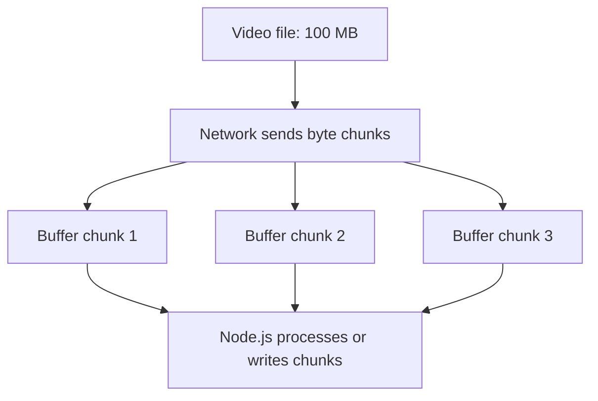
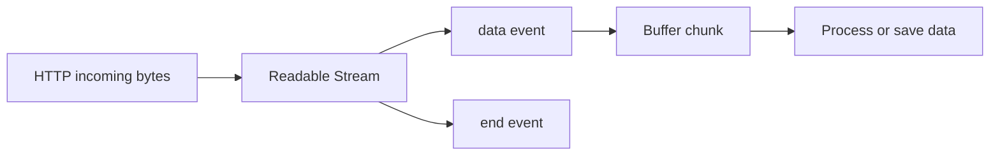

# Lesson 31 — Buffer

## Beginner-Friendly Deep Dive — Buffer Kya Hai Aur Kyun Use Hota Hai?

### 1. Buffer Kya Hota Hai?

**Buffer Node.js ka fixed-length byte container hai jo binary data memory mein store karta hai.** JavaScript strings text ke liye useful hain, lekin network aur files bytes ke saath kaam karte hain.

```js
const buffer = Buffer.from("Hello");
console.log(buffer);            // <Buffer 48 65 6c 6c 6f>
console.log(buffer.toString()); // Hello
```

`48 65 6c 6c 6f` hexadecimal bytes hain. `toString("utf8")` bytes ko text mein decode karta hai. Buffer bytes store karta hai, console unko hex mein display karta hai.

### 2. Buffer Ki Zaroorat Kyun Hai?

Maan lo 100 MB video download ho rahi hai. Network se data chunks mein mil sakta hai. Har chunk binary bytes contain karta hai, jinhe Buffer se represent kiya ja sakta hai.

**Graphics — conceptual data flow:**



Chunk sizes aur count fixed nahi hote. **Buffer automatically memory saving nahi karta**: agar sab chunks collect karoge toh bahut memory lag sakti hai. Streams data incrementally process karne mein help karte hain.

**Common uses:** images, PDFs, audio/video, HTTP bodies, files, network packets, compression, cryptography.

### 3. Practical Example with Exact Output

```js
const buffer = Buffer.from("Vikash");
console.log(buffer);
console.log(buffer.toString());
console.log(buffer.length);
```

**Output:**

```text
<Buffer 56 69 6b 61 73 68>
Vikash
6
```

`buffer.length` **bytes** count karta hai, characters nahi.

```js
const hindi = Buffer.from("नमस्ते");
console.log(hindi.length); // 18 bytes (UTF-8)
```

UTF-8 mein non-ASCII characters multiple bytes le sakte hain.

### 4. Lesson 28 Ke req.on("data") Se Connection

```js
let body = "";

req.on("data", (chunk) => {
  console.log(chunk);
  console.log(Buffer.isBuffer(chunk));
  body += chunk;
});

req.on("end", () => {
  console.log(body);
});
```

By default `http.IncomingMessage` readable stream se `data` event par **Buffer chunks** milte hain. Agar body `Hello` ek chunk mein aayi, possible output:

```text
<Buffer 48 65 6c 6c 6f>
true
Hello
```

`body += chunk` mein Buffer string mein convert hota hai. **Caution:** Multibyte UTF-8 character agar do chunks ke beech split ho jaye, toh har chunk ko separately string mein convert karna text corrupt kar sakta hai.

**Text-only body ke liye safer example:**

```js
req.setEncoding("utf8"); // data events ab decoded strings dete hain
let body = "";

req.on("data", (chunk) => {
  body += chunk;
});

req.on("end", () => {
  console.log(body);
});
```

`setEncoding("utf8")` split UTF-8 sequences correctly decode karta hai. Binary uploads ke liye Buffer chunks ko binary hi rakho. Production request handling mein body size limits, malformed JSON aur aborted streams bhi handle karo.

### 5. Buffer Kaise Create Karte Hain?

**A. Buffer.from(): existing data se**

```js
const buffer = Buffer.from("Hello");
console.log(buffer.toString()); // Hello
```

**B. Buffer.alloc(): zero-filled bytes**

```js
const buffer = Buffer.alloc(5);
console.log(buffer); // <Buffer 00 00 00 00 00>
```

**C. Bytes ko modify karna**

```js
const buffer = Buffer.alloc(3);
buffer[0] = 65;
buffer[1] = 66;
buffer[2] = 67;
console.log(buffer.toString()); // ABC
```

`65`, `66`, `67` decimal byte values hain; Buffer console mein inhe hex `41 42 43` dikhata hai.

### 6. Real-World File Reading Example

Maan lo `hello.txt` mein `Hello Node.js` likha hai.

```js
import fs from "node:fs";

const data = fs.readFileSync("hello.txt");
console.log(data);
console.log(data.toString("utf8"));
```

**Output:**

```text
<Buffer 48 65 6c 6c 6f 20 4e 6f 64 65 2e 6a 73>
Hello Node.js
```

Encoding provide karne par directly string milegi:

```js
const data = fs.readFileSync("hello.txt", "utf8");
console.log(typeof data); // string
```

### 7. Buffer vs Stream vs EventEmitter

| Concept | Kaam | Example |
| --- | --- | --- |
| **Buffer** | Memory mein bytes store karta hai | `Buffer.from("Hello")` |
| **Stream** | Data incrementally read/write karta hai | `fs.createReadStream()` |
| **EventEmitter** | Events register/emit karta hai | `req.on("data", callback)` |

**Analogy:** Buffer = paani hold karne wali bucket; Stream = paani flow karne wala pipe; events = notification ki data aaya ya finish hua.



Node.js `Buffer` technically `Uint8Array` ka subclass hai aur fixed-length byte sequence represent karta hai.

### 8. Quick Practice — Output Predict Karo

```js
const buffer = Buffer.from("ABC");
console.log(buffer);
console.log(buffer.length);
console.log(buffer[0]);
console.log(buffer.toString());
```

**Answer:**

```text
<Buffer 41 42 43>
3
65
ABC
```

**Why?** Buffer console hex bytes dikhata hai; `buffer[0]` decimal byte value `65` return karta hai.

**Final mental model:** **Buffer = bytes ka container**, **Stream = chunks ka flow**, **EventEmitter = data/end notifications**. HTTP `req.on("data")` mein ye teeno saath kaam karte hain.

---

## Why Buffers Exist

JavaScript strings are designed for text.

Servers also handle raw binary data:

- images
- PDFs
- encrypted values
- network packets
- compressed data
- file chunks
- WebSocket frames

Node.js uses `Buffer` to represent raw bytes.

## Create a Buffer

```js
const buffer = Buffer.from("Hello");

console.log(buffer);
```

You may see byte values represented in hexadecimal.

## Convert Back to Text

```js
console.log(buffer.toString("utf8"));
```

Output:

```text
Hello
```

## Mental Model

```text
"Hello"
   |
 UTF-8 encoding
   |
   v
bytes
72 101 108 108 111
   |
   v
Buffer
```

## Buffer.from()

From string:

```js
const buf = Buffer.from(
  "Node.js",
  "utf8"
);
```

From array:

```js
const buf = Buffer.from([
  72,
  105,
]);

console.log(buf.toString());
// Hi
```

## Buffer.alloc()

Allocates a zero-filled buffer.

```js
const buf = Buffer.alloc(10);
```

## Buffer.allocUnsafe()

```js
const buf =
  Buffer.allocUnsafe(10);
```

This can be faster because memory is not guaranteed to be initialized.

Never expose or use contents before fully overwriting the buffer.

For normal application code, prefer `Buffer.alloc` unless you clearly understand the performance/security trade-off.

## Buffer Length

```js
const buf = Buffer.from("Hello");

console.log(buf.length);
```

Length is bytes, not always characters.

Example:

```js
const text = "₹";

console.log(text.length);
console.log(
  Buffer.byteLength(text, "utf8")
);
```

Character count and byte count can differ.

This matters for:
- body limits
- database sizes
- protocol limits
- network payloads

## Encodings

Common encodings:
- utf8
- hex
- base64

### Base64

```js
const encoded = Buffer
  .from("secret")
  .toString("base64");

console.log(encoded);
```

Decode:

```js
const decoded = Buffer
  .from(encoded, "base64")
  .toString("utf8");
```

Important:

> Base64 is encoding, not encryption.

It provides no confidentiality.

## Hex

```js
const hex = Buffer
  .from("hello")
  .toString("hex");
```

Common with:
- hashes
- signatures
- crypto
- binary identifiers

## Comparing Buffers

```js
const a = Buffer.from("hello");
const b = Buffer.from("hello");

console.log(a.equals(b));
// true
```

For secret values, timing-safe comparisons may be more appropriate.

## Concatenate Buffers

```js
const a = Buffer.from("Hello ");
const b = Buffer.from("World");

const result = Buffer.concat([a, b]);

console.log(result.toString());
```

## Buffers and Streams

Streams often emit Buffer chunks.

```js
stream.on("data", (chunk) => {
  console.log(
    Buffer.isBuffer(chunk)
  );
});
```

This is how Node handles large binary or text data incrementally.

## Buffers and HTTP

Request bodies may arrive as Buffer chunks.

Conceptually:

```text
Network
   |
   v
byte chunks
   |
   v
Buffer
   |
   v
decode/parse
   |
   v
JSON/text/file
```

## Buffer and TypedArray

Modern Buffer is closely related to JavaScript typed-array infrastructure and represents byte-oriented memory.

This helps Node integrate efficiently with:
- native code
- networking
- filesystem APIs

## Security Considerations

### Never confuse Base64 with encryption

Bad security:

```text
password -> base64 -> "protected"
```

Anyone can decode it.

### Be careful with allocUnsafe

Uninitialized memory can expose stale bytes if not completely overwritten.

### Limit incoming data

An attacker can send huge payloads.

Enforce:
- body-size limits
- file-size limits
- streaming boundaries

## Industry Example

Payment signature:

```js
const expected =
  Buffer.from(expectedSignature);

const received =
  Buffer.from(receivedSignature);
```

File upload:

```text
HTTP request
   |
   v
Buffer chunks
   |
   v
validation/storage
```

## Interview Questions

### What is a Buffer in Node.js?

A Buffer is a Node.js object for working with raw binary data directly as bytes.

### Why are Buffers important in backend development?

Because files, network packets, encryption, compression and many streams operate on binary data rather than JavaScript strings.

### Is Base64 encryption?

No. Base64 is only an encoding format.

## Interview-Ready Summary

```text
Buffer
   = raw bytes

Common uses
   -> files
   -> streams
   -> network data
   -> crypto
   -> encodings

Buffer.from()
Buffer.alloc()
Buffer.concat()
Buffer.byteLength()
```

## Section 3 Final Mental Model

After this section, connect the core modules like this:

```text
Node.js Core Runtime
        |
        +--> path
        |     filesystem paths
        |
        +--> fs / fs/promises
        |     file operations
        |
        +--> os
        |     machine/runtime information
        |
        +--> url
        |     URL parsing
        |
        +--> events
        |     event-driven architecture
        |
        +--> http
        |     servers and requests
        |
        +--> crypto
        |     security primitives
        |
        +--> util
        |     runtime utilities
        |
        +--> Buffer
              binary data
```

These modules are not isolated topics. Together they form the low-level foundation used underneath frameworks, file processing, networking, authentication, streams, uploads, webhooks and production backend systems.

## Practice Task

Build a small Node.js server without Express that:
1. parses request URLs
2. reads a JSON file using `fs/promises`
3. creates a secure request ID using `crypto.randomUUID()`
4. emits a request event with `EventEmitter`
5. returns JSON through `node:http`
6. uses `path` for file resolution
7. returns Buffer-based file content from one route
