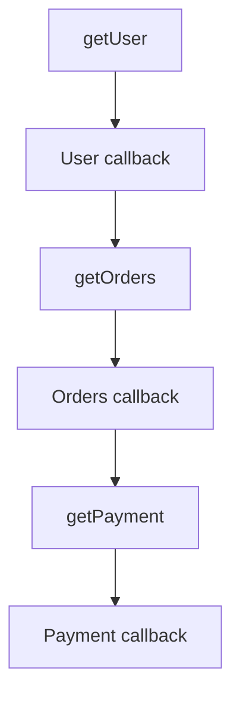

# Lesson 33 — Callbacks

## Start here: Callback → Callback Hell → Promise → Async/Await

Simple Hinglish walkthrough. Har example ko alag run karo. `setTimeout()` database/API delay ko simulate karta hai.

### 1. Callback kaise kaam karta hai?

**Callback ek normal function hai jo hum doosre function ko argument mein pass karte hain.** Receiving function decide karta hai use kab execute karna hai.

**Synchronous callback:**

```js
function greet(callback) {
  console.log('Hello');
  callback();
}

greet(() => console.log('Vikash'));
```

Output: `Hello`, phir `Vikash`. Callback hamesha asynchronous nahi hota.

**Asynchronous callback:**

```js
function getUser(id, callback) {
  console.log('2. getUser started');
  setTimeout(() => {
    const user = { id, name: 'Vikash' };
    callback(null, user);
  }, 1000);
}

console.log('1. Start');
getUser(24, (error, user) => {
  if (error) return console.error(error);
  console.log('4. User:', user);
});
console.log('3. End');
```

Output:

```text
1. Start
2. getUser started
3. End
4. User: { id: 24, name: 'Vikash' }  // ~1 second later
```

**Execution:** `getUser(24, arrowFunction)` mein arrow function sirf pass hua. `setTimeout()` timer schedule karke return ho gaya, toh `End` pehle print hua. Timer complete hone par timer callback ne `callback(null, user)` chalaya — yaani **tumhara passed arrow function invoke hua**. Node.js ka main JS thread timer ke liye block nahi hua.

`callback(error, result)` classic Node.js **error-first callback** convention hai. Success: `callback(null, user)`; failure: `callback(new Error('User not found'))`.

### 2. Callback Hell — complete working example

E-commerce application: **get user → get their orders → get order payment**. Har next step previous result par depend karta hai.

```js
function getUser(id, callback) {
  setTimeout(() => {
    if (!id) return callback(new Error('Invalid user id'));
    callback(null, { id, name: 'Vikash' });
  }, 1000);
}

function getOrders(userId, callback) {
  setTimeout(() => {
    callback(null, [{ id: 101, userId, product: 'Laptop' }]);
  }, 1000);
}

function getPayment(orderId, callback) {
  setTimeout(() => {
    callback(null, { orderId, status: 'SUCCESS', amount: 50000 });
  }, 1000);
}

getUser(24, (error, user) => {
  if (error) return console.error(error);
  console.log('User:', user.name);

  getOrders(user.id, (error, orders) => {
    if (error) return console.error(error);
    console.log('Order:', orders[0].product);

    getPayment(orders[0].id, (error, payment) => {
      if (error) return console.error(error);
      console.log('Payment:', payment.status);
    });
  });
});
```

Output (approximately 1 second gap per line):

```text
User: Vikash
Order: Laptop
Payment: SUCCESS
```



**Callback Hell** ka problem: agar 6–7 dependent tasks hain, callbacks ek-doosre ke andar deeply nested ho jate hain. Readability, debugging aur repeated error checks difficult ho sakte hain. Yeh primarily code organization problem hai, performance problem nahi. Named callback functions mein code split karna bhi nesting kam kar sakta hai.

### 3. Promise se Callback Hell kaise avoid karein?

**Important:** Callback-based `getUser(id, callback)` ko direct `.then()` ke saath use nahi kar sakte. Naye functions **Promise return** karenge. Yahan same three functions ki **Promise-based definitions** hain.

```js
function getUser(id) {
  return new Promise((resolve, reject) => {
    setTimeout(() => {
      if (!id) return reject(new Error('Invalid user id'));
      resolve({ id, name: 'Vikash' });
    }, 1000);
  });
}

function getOrders(userId) {
  return new Promise((resolve) => {
    setTimeout(() => {
      resolve([{ id: 101, userId, product: 'Laptop' }]);
    }, 1000);
  });
}

function getPayment(orderId) {
  return new Promise((resolve) => {
    setTimeout(() => {
      resolve({ orderId, status: 'SUCCESS', amount: 50000 });
    }, 1000);
  });
}

getUser(24)
  .then((user) => {
    console.log('User:', user.name);
    return getOrders(user.id);
  })
  .then((orders) => {
    console.log('Order:', orders[0].product);
    return getPayment(orders[0].id);
  })
  .then((payment) => {
    console.log('Payment:', payment.status);
  })
  .catch((error) => console.error('Error:', error.message));
```

Output:

```text
User: Vikash
Order: Laptop
Payment: SUCCESS
```

**Difference:** Callback API `getUser(id, callback)` result ko `callback(null, user)` se deta tha. Promise API `getUser(id)` ek Promise return karta hai: `resolve(user)` success, `reject(error)` failure. `.then()` result handle karta hai aur `.catch()` rejection.

**`return getOrders(user.id)` kyun?** Uske returned Promise ko chain mein forward karna zaroori hai. Agar `return` hata doge, next `.then((orders) => ...)` ko `undefined` milega.

**Relation:** `.then((user) => {...})` mein arrow function bhi ek callback hai. Promise callbacks ko eliminate nahi karta — unhe organized way mein manage karta hai.

### 4. Same functions ko async/await aur try/catch ke saath use karo

**Definitions bilkul SAME rahengi as section 3.** Promise-based `getUser`, `getOrders`, `getPayment` ko dubara define karne ki zaroorat nahi.

```js
// Pehle section 3 ke Promise-based definitions use karo.
async function getPaymentDetails() {
  try {
    const user = await getUser(24);
    console.log('User:', user.name);

    const orders = await getOrders(user.id);
    console.log('Order:', orders[0].product);

    const payment = await getPayment(orders[0].id);
    console.log('Payment:', payment.status);
  } catch (error) {
    console.error('Error:', error.message);
  }
}

getPaymentDetails();
```

Output:

```text
User: Vikash
Order: Laptop
Payment: SUCCESS
```

`async` function **always Promise return** karta hai. `await` current async function ko suspend karta hai jab tak Promise settle na ho; normally Node.js main JavaScript thread block nahi hota. Promise reject ho toh `await` error throw karta hai, jise `try/catch` handle kar sakta hai.

**Try the error case:** `await getUser(0)` likho. `reject(new Error('Invalid user id'))` hoga, orders aur payment skip honge, aur `catch` print karega:

```text
Error: Invalid user id
```

**Yaad rakho:** Async/await Promise ka replacement nahi hai. Same Promise-returning functions ko readable syntax mein consume karta hai. Ye three dependent operations sequentially run hote hain.

### 5. Quick comparison

| Callback | Promise | Async/Await |
| --- | --- | --- |
| Function argument pass karo | Promise return karo | Same Promise function use karo |
| `callback(null, user)` | `resolve(user)` | `const user = await getUser(24)` |
| `callback(error)` | `reject(error)` / `.catch()` | `try/catch` |
| Deep nesting possible | `.then()` chain | Sequential-looking code |

### 6. Practice questions

1. Async callback example mein `End` pehle kyun aaya?
2. `callback(null, user)` mein `null` ka role kya hai?
3. `.then()` mein `return getOrders(user.id)` hataoge toh kya hoga?
4. `await getUser(0)` par `try` ya `catch` mein se kaunsa handle karega?

---

## More details from the original lesson

## Why callbacks matter

Callbacks are one of the foundations of asynchronous Node.js.

Modern code often uses promises and async/await, but callbacks are still important because:

- many Node.js APIs historically use them
- EventEmitter listeners are callbacks
- HTTP handlers are callbacks
- timers use callbacks
- understanding callbacks makes promises easier to understand
- interviewers often ask about error-first callbacks

---

## 1. What is a callback?

A callback is a function passed to another function so it can be executed later.

Simple example:

```js
function greet(name, callback) {
  console.log(`Hello ${name}`);

  callback();
}

greet("Vikash", () => {
  console.log("Callback executed");
});
```

Output:

```text
Hello Vikash
Callback executed
```

---

## 2. Callback does not always mean asynchronous

This is important.

Example:

```js
[1, 2, 3].map((number) => {
  return number * 2;
});
```

The function passed to `map` is a callback.

But it runs synchronously.

So:

```text
callback
   !=
asynchronous
```

A callback is simply a function passed for later invocation by another function.

---

## 3. Asynchronous callback

Example:

```js
setTimeout(() => {
  console.log("Executed later");
}, 1000);
```

The callback is registered now and executed later.

---

## 4. Node-style error-first callbacks

A classic Node.js convention is:

```text
callback(error, result)
```

Example:

```js
import fs from "node:fs";

fs.readFile("data.txt", "utf8", (err, data) => {
  if (err) {
    console.error(err);
    return;
  }

  console.log(data);
});
```

The first parameter represents an error.

The second contains the successful result.

Mental model:

```text
operation succeeds
   -> callback(null, result)

operation fails
   -> callback(error)
```

---

## 5. Writing your own error-first callback API

```js
function divide(a, b, callback) {
  if (b === 0) {
    callback(new Error("Cannot divide by zero"));
    return;
  }

  callback(null, a / b);
}

divide(10, 2, (err, result) => {
  if (err) {
    console.error(err.message);
    return;
  }

  console.log(result);
});
```

---

## 6. Why use return after error?

Look at:

```js
if (err) {
  callback(err);
  return;
}
```

or:

```js
if (err) {
  return callback(err);
}
```

This prevents the function from continuing and accidentally calling the callback again.

---

## 7. The "callback exactly once" rule

A callback-based async API should generally invoke its callback once.

Bad:

```js
function getUser(id, callback) {
  if (!id) {
    callback(new Error("Missing id"));
  }

  callback(null, {
    id,
    name: "Vikash",
  });
}
```

If `id` is missing, callback may be called twice.

Correct:

```js
function getUser(id, callback) {
  if (!id) {
    return callback(
      new Error("Missing id")
    );
  }

  callback(null, {
    id,
    name: "Vikash",
  });
}
```

Double-callback bugs can cause extremely confusing behavior.

---

## 8. Asynchronous callback flow

```js
console.log("1");

setTimeout(() => {
  console.log("2");
}, 0);

console.log("3");
```

Output:

```text
1
3
2
```

Why?

The callback is not executed immediately.

It becomes eligible later.

The current synchronous stack completes first.

---

## 9. Higher-order functions

A function that accepts another function is called a higher-order function.

Example:

```js
function processUser(user, handler) {
  handler(user);
}
```

Callbacks are closely related to higher-order functions.

---

## 10. Real Node.js examples

### Timer

```js
setTimeout(() => {
  console.log("done");
}, 1000);
```

### HTTP server

```js
import http from "node:http";

http.createServer((req, res) => {
  res.end("Hello");
});
```

The request handler is a callback.

### EventEmitter

```js
emitter.on("message", (message) => {
  console.log(message);
});
```

The listener is a callback.

---

## 11. Why callbacks became difficult

Consider a workflow:

```text
find user
   |
   v
load orders
   |
   v
load payment
   |
   v
send notification
```

With nested callbacks:

```js
findUser(id, (err, user) => {
  if (err) return handleError(err);

  findOrders(user.id, (err, orders) => {
    if (err) return handleError(err);

    findPayment(orders[0].id, (err, payment) => {
      if (err) return handleError(err);

      sendNotification(payment, (err) => {
        if (err) return handleError(err);

        console.log("done");
      });
    });
  });
});
```

This becomes hard to:
- read
- test
- debug
- maintain
- handle errors consistently

This leads to callback hell, which is covered in the next lesson.

---

## 12. Callback error handling

In asynchronous callbacks, errors often cannot be handled with an outer synchronous try/catch.

Example:

```js
try {
  setTimeout(() => {
    throw new Error("Failure");
  }, 100);
} catch (error) {
  console.log("Will not catch this");
}
```

The callback runs later, after the outer try/catch has already completed.

You need to handle errors where the async work executes.

---

## 13. Common mistakes

### Mistake 1 — Assuming every callback is asynchronous

Wrong.

`map`, `filter`, and `forEach` callbacks are usually synchronous.

### Mistake 2 — Calling callback twice

This creates unpredictable behavior.

### Mistake 3 — Forgetting error-first convention

Classic Node APIs expect:

```text
(error, result)
```

### Mistake 4 — Throwing inside async callback and expecting outer try/catch to catch it

Usually wrong.

### Mistake 5 — Mixing callbacks and promises without clear boundaries

This can lead to double handling and confusing control flow.

---

## 14. Interview questions

### What is a callback?

A callback is a function passed to another function so it can be invoked by that function later.

### Are callbacks always asynchronous?

No. A callback can run synchronously or asynchronously depending on how the receiving function uses it.

### What is an error-first callback?

A Node.js convention where the callback receives an error as the first argument and the result as the second:

```text
callback(error, result)
```

### Why were callbacks heavily used in Node.js?

They provided a simple way to continue execution after asynchronous I/O completed.

---

## 15. Strong interview answer

> A callback is a function passed to another function for execution later. In classic Node.js asynchronous APIs, callbacks often follow the error-first convention, where the first argument is an error and the second is the result. Callbacks themselves are not inherently asynchronous, but they were widely used to represent completion of async operations. Deeply nested callbacks can make control flow and error handling difficult, which is one reason promises and async/await became preferred for many workflows.

---

## Interview-Ready Summary

```text
Callback
  -> function passed to another function

Node-style callback
  -> callback(error, result)

Important rules
  -> callback may be sync or async
  -> handle errors
  -> call once
  -> avoid deep nesting
```

## Practice Task

Create your own callback-based function:

```text
getUserById(id, callback)
```

Requirements:
- invalid ID returns an error
- valid ID returns a user
- callback must never execute twice
