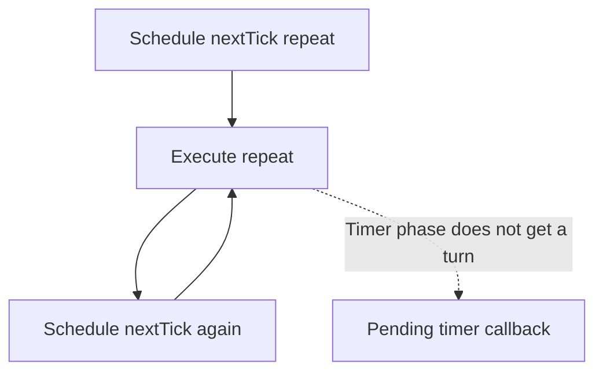

# Lesson 42 — Node.js Event Loop

## Why this lesson matters

The event loop is one of the most important Node.js interview topics.

If you truly understand it, you can explain:

- why Node.js handles many concurrent I/O operations well
- why async callbacks do not run immediately
- why CPU-heavy code blocks the server
- why promises and timers have different execution timing
- how Node.js can be "single-threaded" and still handle thousands of connections

This lesson builds the mental model. The next lessons go deeper into the individual phases and queues.

---

## 1. What is the event loop?

The event loop is the mechanism that allows Node.js to coordinate asynchronous work and execute callbacks when the JavaScript call stack becomes free.

A strong short definition:

> The Node.js event loop continuously checks whether asynchronous callbacks are ready to run and schedules them onto the JavaScript execution thread when the call stack is available.

---

## 2. The core problem Node.js solves

Imagine a server handling:

- database queries
- HTTP requests
- file reads
- Redis calls
- timers

Most of these spend a lot of time waiting.

A naive blocking model would look like:

```text
Request A
   |
   v
wait 500ms for DB
   |
   v
respond
   |
   v
Request B starts
```

That wastes time.

Node.js instead allows waiting operations to progress outside the main JavaScript execution path.

```text
Request A -> DB wait -----------+
Request B -> Redis wait ----+   |
Request C -> API wait ---+  |   |
                        |  |   |
                        v  v   v
                 callbacks become ready
```

The event loop decides when those callbacks can execute.

---

## 3. Main JavaScript thread

Node.js executes normal JavaScript primarily on one main thread.

Example:

```js
console.log("A");

console.log("B");

console.log("C");
```

This runs sequentially.

```text
Call Stack
   |
   v
A
   |
   v
B
   |
   v
C
```

---

## 4. Asynchronous example

```js
console.log("Start");

setTimeout(() => {
  console.log("Timer");
}, 0);

console.log("End");
```

Output:

```text
Start
End
Timer
```

Why does the timer not run immediately?

Because:

1. synchronous code runs first
2. timer callback becomes eligible later
3. callback waits until the stack is empty
4. event loop schedules it

---

## 5. Simplified event loop model

```text
           JavaScript Call Stack
                   |
                   v
          synchronous code runs
                   |
                   v
             stack becomes empty
                   |
                   v
              Event Loop
                   |
        +----------+----------+
        |                     |
        v                     v
 ready callbacks       microtasks
        |                     |
        +----------+----------+
                   |
                   v
           next callback runs
```

This is simplified, but very useful.

---

## 6. The event loop does not perform all async work itself

A common interview mistake is saying:

> The event loop executes file reads and network requests.

Not exactly.

The event loop coordinates completion and callback execution.

Actual waiting/work may involve:

- operating system networking facilities
- libuv
- libuv thread pool
- native APIs

Better mental model:

```text
JavaScript
   |
   v
Node API
   |
   v
OS / libuv / thread pool
   |
   v
operation completes
   |
   v
callback becomes ready
   |
   v
event loop schedules callback
```

---

## 7. Example with file I/O

```js
import fs from "node:fs";

console.log("1");

fs.readFile("data.txt", "utf8", () => {
  console.log("2");
});

console.log("3");
```

Typical output:

```text
1
3
2
```

Execution:

```text
console.log("1")
      |
      v
request file read
      |
      +----------------------+
      |                      |
      v                      |
console.log("3")             |
      |                      |
      v                      |
stack empty                  |
                             |
                 file read finishes
                             |
                             v
                  callback becomes ready
                             |
                             v
                 event loop schedules it
                             |
                             v
                  console.log("2")
```

---

## 8. Event loop and CPU-heavy code

The event loop can only schedule more JavaScript when the main thread is available.

Example:

```js
setTimeout(() => {
  console.log("Timer finished");
}, 0);

const start = Date.now();

while (Date.now() - start < 5000) {
  // block for 5 seconds
}
```

The timer does not run after 0 ms.

It waits until the blocking loop finishes.

This proves:

```text
timer delay
   !=
guaranteed execution time
```

The delay is the minimum wait before eligibility.

---

## 9. Why CPU blocking is dangerous in APIs

Suppose:

```js
app.get("/heavy", (req, res) => {
  const result = expensiveCalculation();

  res.json(result);
});
```

While that calculation is running:

```text
Request A
  |
  v
CPU-heavy work
  |
  | blocks event loop
  |
Request B waits
Request C waits
Request D waits
```

This damages:
- latency
- throughput
- user experience
- timeout behavior

---

## 10. I/O concurrency

Node.js is very good when requests spend time waiting.

Example:

```text
Request A -> DB query
Request B -> Redis
Request C -> HTTP service
Request D -> file read
```

These can overlap.

The main thread only needs to process JavaScript around the waiting periods.

That is why Node.js performs well for many I/O-heavy systems.

---

## 11. Event loop is not the same as a thread pool

Important distinction:

```text
Event Loop
  -> schedules callbacks

Thread Pool
  -> performs selected blocking/native operations in worker threads
```

The event loop itself is not "a pool of worker threads."

---

## 12. Event loop + libuv

libuv is a native library used by Node.js.

It provides major runtime features such as:

- event loop implementation
- thread pool
- asynchronous I/O abstractions
- timers
- filesystem support
- networking abstractions

Mental model:

```text
Node.js
   |
   +--> V8
   |
   +--> libuv
          |
          +--> event loop
          +--> thread pool
          +--> OS async I/O
```

---

## 13. Event loop iterations

One full pass through event loop phases is often called a "tick" or iteration.

Conceptually:

```text
iteration 1
   |
   v
check ready work
   |
   v
run callbacks
   |
   v
microtasks
   |
   v
next phases
   |
   v
iteration 2
```

The exact behavior is more structured, and the next lesson covers the phases.

---

## 14. Promises and event loop

Promises are also related to event loop execution ordering.

Example:

```js
console.log("A");

Promise.resolve().then(() => {
  console.log("B");
});

setTimeout(() => {
  console.log("C");
}, 0);

console.log("D");
```

Typical output:

```text
A
D
B
C
```

Why?

Because Promise handlers are processed as microtasks before the timer callback phase gets its turn.

We will go deeper into this in upcoming lessons.

---

## 15. Event loop starvation

### 15.1 Starvation kya hota hai? (Simple meaning)

**Event Loop Starvation** tab hota hai jab baar-baar schedule hone wale callbacks/microtasks Node.js ko agle event-loop phases tak pahunchne ka chance nahi dete. Isliye ready timers, I/O callbacks aur requests wait kar sakte hain.

Real-life example: Restaurant mein waiter baar-baar Customer A ka kaam kar raha hai; Customer B aur C wait kar rahe hain. Node.js mein bhi ek endlessly replenished high-priority queue doosre callbacks ko wait karwa sakti hai.

**Important difference:**

- **Blocking:** Ek long synchronous CPU-heavy function main thread busy rakhta hai (jaise 5-second `while` loop).
- **Starvation:** Bahut saare callbacks/microtasks ek-doosre ko schedule karte rehte hain, jis se doosre phases ki turn nahi aati.
- Dono timers aur incoming requests delay kar sakte hain. Broadly starvation mein long synchronous tasks bhi contribute kar sakte hain, lekin `process.nextTick()` recursion ek especially clear example hai.

### 15.2 Working example — `process.nextTick()` repeatedly schedule hona

**Complete runnable code (`node starvation.js`):**

```js
console.log('Start');

setTimeout(() => {
  console.log('Timer executed');
}, 0);

let count = 0;

function repeat() {
  count++;
  console.log('nextTick:', count);

  if (count < 5) {
    process.nextTick(repeat);
  }
}

process.nextTick(repeat);
console.log('End');
```

**Expected output (Node.js CommonJS file):**

```text
Start
End
nextTick: 1
nextTick: 2
nextTick: 3
nextTick: 4
nextTick: 5
Timer executed
```

**Execution step-by-step:**

1. `Start` print hota hai.
2. `setTimeout(..., 0)` timer schedule karta hai. `0` ka matlab immediately execute karna **nahi** hai.
3. `process.nextTick(repeat)` callback ko next-tick queue mein schedule karta hai.
4. Current synchronous code se `End` print hota hai.
5. Node.js next-tick queue drain karta hai. `repeat()` ke andar fir se `process.nextTick(repeat)` schedule hota hai.
6. Count 5 hone tak ye chain chalti hai. Uske baad timer callback execute ho sakta hai.

> This exact order is intended for a normal Node.js **CommonJS** script. In an ES module's top-level execution, Promise microtask/`nextTick` ordering can differ. The important idea here is how a recursive next-tick chain delays timers.

### 15.3 Actual starvation — jab recursion kabhi stop na ho

```js
setTimeout(() => {
  console.log('Timer executed');
}, 0);

function repeat() {
  // No log here to avoid flooding the terminal.
  process.nextTick(repeat);
}

process.nextTick(repeat);
```

**Behavior:** Timer callback ko execution ka chance nahi milega as long as the infinite `nextTick` chain continues. Process unresponsive/high CPU ho sakta hai. Test karte waqt `Ctrl + C` se stop karo.

**Why?** Har `repeat()` fir next-tick queue mein ek callback daal raha hai. Node.js baar-baar us queue ko drain karta hai aur timer phase tak progress nahi kar pata.



**Promise microtask chain** ka bhi similar effect ho sakta hai, agar wo continuously naye microtasks schedule kare aur event loop ko yield na kare.

### 15.4 Solution — Event Loop ko yield karo (`setImmediate`)

Kaam ko **small chunks** mein divide karo aur har chunk ke baad `setImmediate()` se next turn schedule karo. Isse Node.js ko timers/I/O ko service karne ke opportunities milti hain.

```js
let count = 0;

function repeat() {
  count++;
  console.log('Working:', count);

  if (count < 5) {
    setImmediate(repeat);
  }
}

setTimeout(() => {
  console.log('Timer executed');
}, 0);

setImmediate(repeat);
```

**Possible output:**

```text
Timer executed
Working: 1
Working: 2
Working: 3
Working: 4
Working: 5
```

**Important:** Top-level `setTimeout(..., 0)` vs `setImmediate()` ka relative order **guaranteed nahi** hai. Kisi run mein `Working: 1` timer se pehle bhi aa sakta hai; important part ye hai ki `setImmediate` chain timers ko indefinitely starve nahi karti.

`setImmediate()` synchronous CPU-heavy code ko non-blocking **nahi** banata. Agar ek chunk hi bohot heavy hai, use further split karo ya CPU-intensive kaam ke liye Worker Threads consider karo.

### 15.5 Blocking vs Starvation — quick comparison

| Event loop blocking | Event loop starvation |
| --- | --- |
| Ek long synchronous task main JS thread occupy karta hai | High-priority callbacks/microtasks repeatedly schedule hote hain |
| Example: `while` loop 5 seconds tak | Example: endless `process.nextTick(repeat)` |
| Callback tab chalega jab heavy task finish hoga | Timer/I/O tabhi chance paayenge jab chain yield/end kare |
| Fix: reduce/split CPU work, Worker Threads | Fix: break chains, yield via `setImmediate`, use bounded work |

### 15.6 Interview answer

> Event loop starvation occurs when continuously queued high-priority callbacks or microtasks prevent the Node.js event loop from progressing to other phases, delaying timers and I/O. A recursive `process.nextTick()` chain is a common example. Avoid it by breaking up work and yielding control, for example using `setImmediate()`.

**Practice:** Agar `process.nextTick()` callback khud ko forever schedule kare aur `setTimeout(..., 0)` bhi registered ho, kya timer run hoga? **Nahi**, jab tak uninterrupted chain chalti rahegi.

---

## 16. Production symptom of event loop blocking

You may see:

```text
CPU high
response time high
requests timing out
database looks normal
memory maybe normal
```

The real cause may be event-loop blocking.

Typical causes:

- JSON processing on huge payloads
- expensive regex
- crypto done synchronously
- huge loops
- synchronous filesystem calls
- image transformation
- compression

---

## 17. Interview questions

### What is the Node.js event loop?

It is the mechanism that coordinates asynchronous callbacks and executes them when the JavaScript call stack is free.

### Does the event loop execute I/O operations itself?

No. I/O is typically handled by the operating system, libuv, or its thread pool. The event loop schedules completion callbacks.

### Why does setTimeout(fn, 0) not execute immediately?

Because the callback is only eligible after the timer delay and still has to wait until the event loop reaches the relevant phase and the call stack is free.

### Why does CPU-heavy JavaScript block Node.js?

Because normal JavaScript executes on the main thread, preventing the event loop from scheduling other callbacks until that work completes.

---

## 18. Strong interview answer

> The Node.js event loop allows a single JavaScript execution thread to coordinate many asynchronous I/O operations. Node delegates waiting work to the operating system, libuv, or the libuv thread pool. When those operations complete, their callbacks become ready, and the event loop schedules them when the call stack is free. This is why Node.js is efficient for I/O-heavy workloads, while CPU-heavy synchronous code can block the event loop and delay all other callbacks.

---

## Interview-Ready Summary

```text
Event Loop
   |
   +--> coordinates async callbacks
   +--> runs callbacks when stack is free
   +--> works with libuv + OS
   +--> excellent for I/O concurrency
   +--> blocked by CPU-heavy JS

Important:
event loop != thread pool
timer delay != exact execution time
async != automatic parallel JavaScript
```

## Practice Task

Predict the output before running:

```js
console.log("A");

setTimeout(() => {
  console.log("B");
}, 0);

Promise.resolve().then(() => {
  console.log("C");
});

console.log("D");
```

Then explain every line in terms of:
- call stack
- microtasks
- event loop
