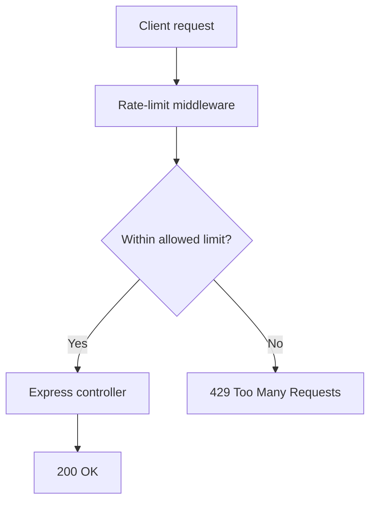
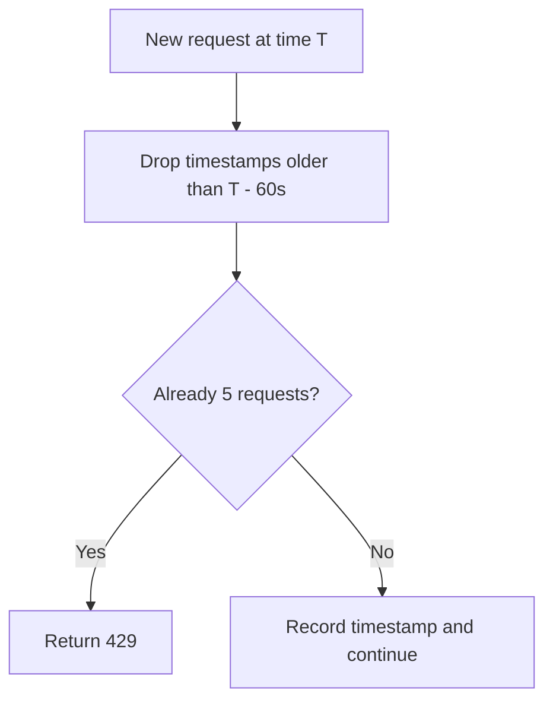
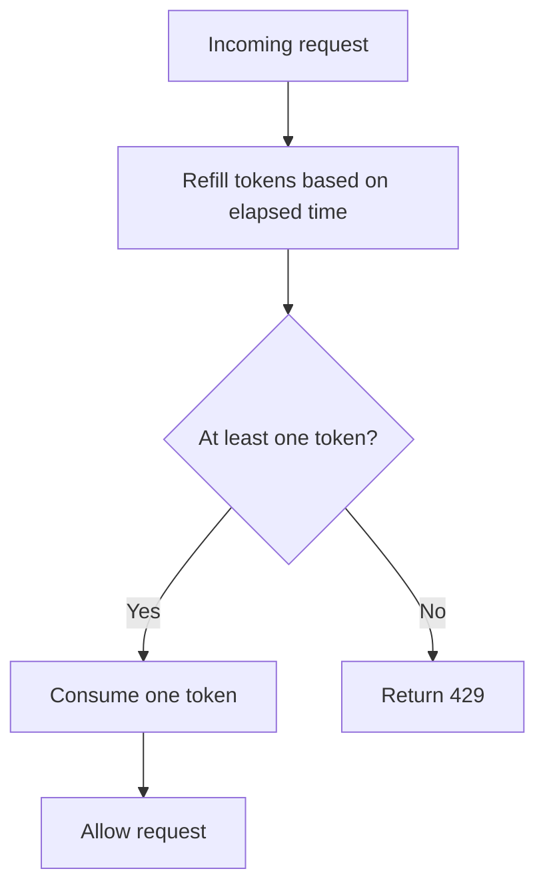
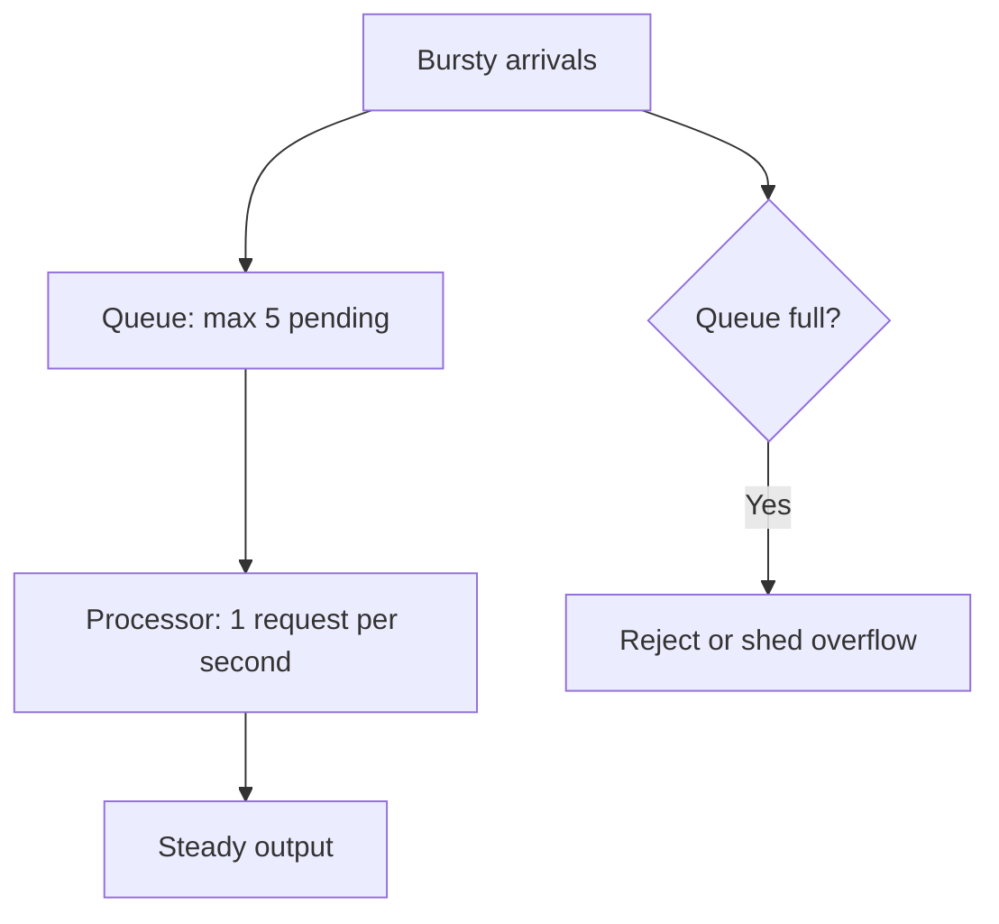
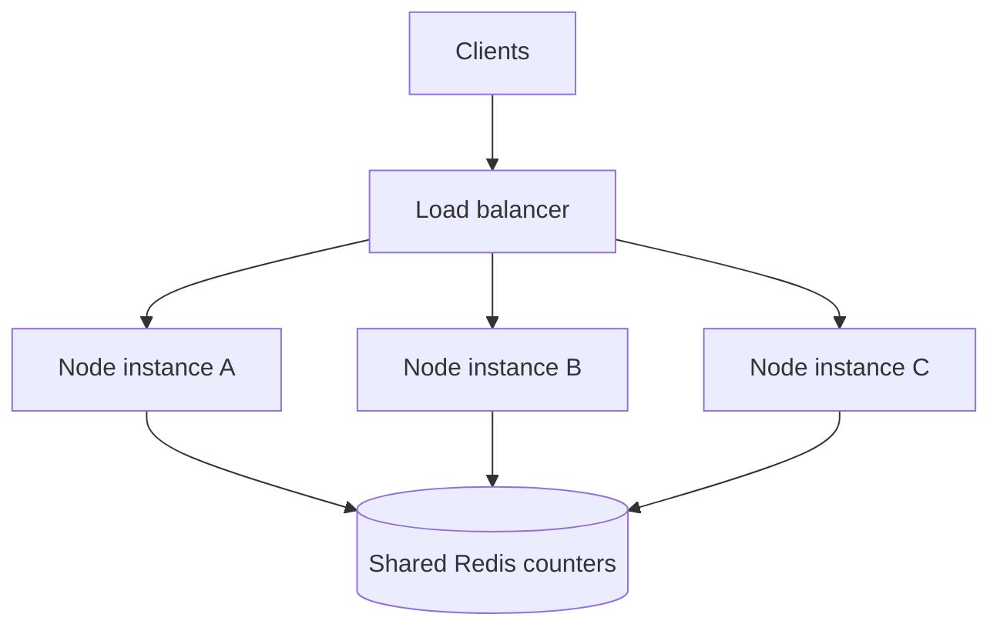

# Lesson 104 — Rate Limiting

## Why rate limiting matters

Rate limiting protects APIs from:

- abuse
- brute-force attacks
- accidental client loops
- scraping
- resource exhaustion
- expensive endpoint misuse

It is both a reliability and security control.

---

## 1. What is rate limiting?

Rate limiting restricts how many requests a client can make within a period.

Example:

```text
100 requests / minute
```

After that:

```text
429 Too Many Requests
```

---

## 2. What identifies a client?

Possible keys:

- IP address
- user ID
- API key
- tenant ID
- route + user
- organization ID

The right key depends on the API.

---

## 3. IP-based limiting

Simple:

```text
key = client IP
```

Useful for:
- public endpoints
- anonymous login attempts

Problems:
- shared NAT
- mobile networks
- proxies
- attacker IP rotation

---

## 4. User-based limiting

Authenticated API:

```text
key = userId
```

More accurate for logged-in clients.

---

## 5. API-key limiting

Public developer APIs often rate-limit per API key.

This enables:
- usage plans
- quotas
- billing tiers

---

# Rate-limiting Algorithms

## 6. Fixed window

Example:

```text
100 requests
per 60-second window
```

Simple.

Problem:

Client can send:

```text
100 requests at 12:00:59
+
100 requests at 12:01:00
```

Effectively 200 requests in 2 seconds.

---

## 7. Sliding window log

Store timestamps of requests and count requests in the last N seconds.

Accurate but memory-expensive at high scale.

---

## 8. Sliding window counter

Approximate sliding behavior using counters from adjacent windows.

Better efficiency than storing every timestamp.

---

## 9. Token bucket

Bucket contains tokens.

Each request consumes one.

Tokens refill over time.

```text
Bucket: 10 tokens

Request -> 9
Request -> 8

time passes
  |
  v
tokens refill
```

Allows controlled bursts.

---

## 10. Leaky bucket

Requests enter a queue/bucket and leave at a controlled rate.

Useful for smoothing traffic.

Conceptually:

```text
bursty input
   |
   v
bucket
   |
   v
steady output
```

---

## 11. Which algorithm is best?

Depends on needs.

Fixed window:
- simple

Token bucket:
- common
- burst-friendly

Sliding window:
- more precise fairness

Leaky bucket:
- smooth output

---

## 12. 429 response

```http
HTTP/1.1 429 Too Many Requests
Retry-After: 60
```

Body:

```json
{
  "error": {
    "code": "RATE_LIMITED",
    "message": "Too many requests"
  }
}
```

---

## 13. Useful rate-limit headers

APIs may expose standardized or conventional headers showing:

- limit
- remaining
- reset time

Follow current standards/library behavior.

Do not invent inconsistent header names without reason.

---

## 14. Login rate limiting

Login should be stricter.

Example:

```text
5 failed attempts / 15 minutes
```

Potential keys:
- IP
- account/email
- combination of both

Using only one dimension can be bypassed or harm legitimate users.

---

## 15. Password reset

Very important to limit:

```text
POST /forgot-password
```

Otherwise attackers can:
- spam email
- enumerate accounts
- create provider cost

---

## 16. Expensive endpoint limiting

Example:

```text
POST /generate-report
```

may be far more expensive than:

```text
GET /health
```

Use route-specific limits.

---

## 17. Global vs endpoint limits

Global:

```text
1000 requests/min
```

Route-specific:

```text
/login -> 5/min
/search -> 60/min
/export -> 2/min
```

This is often more effective.

---

## 18. In-memory rate limiting

Single process:

```text
memory counter
```

works for development or a single instance.

But with multiple instances:

```text
Instance A counter = 50
Instance B counter = 40
```

Client effectively gets 90.

Distributed apps need shared state.

---

## 19. Redis-based limiting

Shared Redis:

```text
Instance A
Instance B
Instance C
    |
    v
 Redis
```

Now all instances see the same counters.

---

## 20. Atomicity

Rate-limit counters must be updated atomically.

Bad:

```text
read count
increment in app
write count
```

Concurrent requests can race.

Use atomic Redis operations/scripts/transactions.

---

## 21. Reverse proxy/CDN rate limiting

Rate limiting can also happen at:

- CDN
- API gateway
- Nginx
- cloud load balancer

This blocks abusive traffic before it reaches Node.js.

---

## 22. Defense in depth

Good architecture may use:

```text
CDN / Gateway limit
        |
        v
App-level route limit
        |
        v
Business quota
```

Different layers solve different problems.

---

## 23. Rate limiting vs quota

Rate limit:

```text
100 requests/minute
```

Quota:

```text
10,000 requests/month
```

Different concepts.

Both may exist together.

---

## 24. Rate limiting vs concurrency limiting

Rate limit:

```text
requests per time
```

Concurrency limit:

```text
max requests processing simultaneously
```

An export endpoint might need both.

---

## 25. Distributed system caveat

Strict global rate limiting across regions can be expensive because of coordination.

Sometimes systems accept approximate regional limits for performance.

Trade-off:
- global precision
- latency/availability

---

## 26. Trust proxy

If using IP-based limits behind a reverse proxy, configure proxy trust correctly.

Otherwise:

```text
all clients appear to come from proxy IP
```

or malicious forwarded headers may be trusted incorrectly.

---

## 27. Do not block event loop

Rate-limit storage checks should be efficient.

Do not do:
- slow synchronous disk operations
- heavy computation
- full DB scans

in middleware.

---

## 28. Bypass strategy

Some internal/health endpoints may need different rules.

But avoid broad bypass rules such as:

```text
if internal header exists -> unlimited
```

unless the header is strongly authenticated.

---

## 29. Common mistakes

### Mistake 1
Only global one-size-fits-all limit.

### Mistake 2
In-memory limit in multi-instance production.

### Mistake 3
No atomic updates.

### Mistake 4
Wrong IP behind proxy.

### Mistake 5
No stricter auth endpoint protection.

### Mistake 6
Confusing rate limit with quota.

---

## 30. Interview questions

### What is rate limiting?

Controlling how many requests a client can make within a defined period.

### Which status code?

429 Too Many Requests.

### Why use Redis in distributed apps?

To maintain shared counters across multiple instances.

### Token bucket vs fixed window?

Fixed window is simpler; token bucket supports controlled bursts more naturally.

### Why route-specific limits?

Different endpoints have different cost and security risk.

---

## 31. Strong interview answer

> Rate limiting protects APIs from abuse and overload by limiting request frequency per IP, user, API key, or tenant. For simple single-instance systems, in-memory counters can work, but distributed services usually need a shared atomic store such as Redis or gateway-level enforcement. I apply stricter limits to sensitive or expensive endpoints like login, password reset, search, and report generation, return 429 with retry guidance, and choose an algorithm such as token bucket when controlled bursts are acceptable.

---

## Interview-Ready Summary

```text
Rate Limit
   |
   +--> IP
   +--> user
   +--> API key
   +--> tenant

Algorithms:
fixed window
sliding window
token bucket
leaky bucket

Distributed:
Redis / gateway

Response:
429 + Retry-After
```

## Practice Task

Design rate limits for:

- login
- forgot password
- product search
- checkout
- report generation
- public API key

Choose:
- key
- algorithm
- limit
- storage

---

# Hands-on walkthrough — Express 5

## 32. Visual overview

Rate limiting sits before your controller. Allowed requests reach the controller; excess requests receive HTTP 429.



**Example:** Allow 5 requests per minute per IP. The first five are accepted and the sixth is blocked. After its applicable window has reset or expired, requests can be accepted again.

### Why do we need it?

Imagine a login API receives 10,000 requests in one minute. A limiter reduces brute-force attempts, accidental client loops, scraping, resource exhaustion, and unnecessary cost. It is one protective layer, **not complete DDoS protection**.

## 33. Fixed window — timeline graphic

A fixed-window counter tracks requests in fixed time slots.

```text
10:00:00                      10:00:59 | 10:01:00
   [ 5 requests allowed / minute ]         [counter reset]
                                    5 here ↑ ↑ 5 here
                         Potentially 10 requests near boundary!
```


**Pros:** easy, fast, low storage. **Con:** clock-boundary bursts; it does not enforce an exact rolling 60-second rule.

## 34. Sliding window — timeline graphic

A sliding window counts requests in the **last 60 seconds measured from now**, rather than in a fixed wall-clock minute.

```text
Request times (seconds): 5, 12, 23, 35, 50, 65, 72
Current time = 72 s
Rolling window = (12, 72] s
Counted: 23, 35, 50, 65, 72 = 5 requests
A new request at second 72 would be blocked (limit 5).
```



**Sliding-window log:** exact within its timestamp granularity, but stores each request time. **Sliding-window counter:** approximates using neighbouring window counters; lower memory usage.

## 35. Token bucket — graphic and worked example

Bucket capacity: **5 tokens**. Each accepted request consumes **1 token**. Refill rate: **1 token every 2 seconds**, with a maximum of 5.

```text
Initially:      ● ● ● ● ●    5 tokens
After 3 calls:  ● ● ○ ○ ○    2 tokens
After 4s:      ● ● ● ● ○    4 tokens
After 5 calls: ○ ○ ○ ○ ○    0 tokens -> next call gets 429
```



This enables short bursts while enforcing a longer-term average. A production implementation must refill and consume atomically when multiple workers share a bucket.

## 36. Leaky bucket — graphic

Think of a queue with a capacity of 5 requests; a worker processes at a controlled rate, such as 1 request per second.



**Token bucket vs leaky bucket:** Token bucket allows bursts immediately (when tokens exist); queue-based leaky bucket smooths processing and may delay requests. A traffic-shaping queue is not identical to a middleware that immediately rejects calls.

## 37. Quick algorithm selection table

| Algorithm | Main benefit | Main trade-off | Typical use |
| --- | --- | --- | --- |
| Fixed window | Minimal complexity | Boundary spikes | Simple request quotas |
| Sliding-window log | Precise rolling period | Per-request timestamp storage | Sensitive/auth endpoints |
| Sliding-window counter | Less memory | Approximate near boundaries | High-volume rolling limits |
| Token bucket | Allows controlled bursts | Must manage refill state | Public and bursty APIs |
| Leaky bucket | Smooth downstream load | Queue delay and overflow policy | Workers, job processing |

**Choose based on needs**, not one universal winner. These are algorithm families; libraries may implement their own variants.

## 38. Install Express rate-limit middleware

```bash
npm install express express-rate-limit
```

**middlewares/rateLimiter.js**

```js
import { rateLimit } from "express-rate-limit";

export const apiLimiter = rateLimit({
  windowMs: 60 * 1000, // 1 minute
  limit: 100,          // per IP by default
  standardHeaders: "draft-8",
  legacyHeaders: false,
  message: {
    success: false,
    message: "Too many requests. Try again later.",
  },
});
```

**app.js (Express 5)**

```js
import express from "express";
import { apiLimiter } from "./middlewares/rateLimiter.js";

const app = express();
app.use(express.json());
app.use("/api", apiLimiter);

app.get("/api/users", (req, res) => {
  res.json({ success: true, message: "Users fetched successfully" });
});

app.listen(3000, () => console.log("Listening on port 3000"));
```

Requests under `/api` are subject to the limiter. With default in-memory counters, this is suitable for local learning or simple single-process deployments, **not reliably global across replicas**. The common `express-rate-limit` default store follows fixed-window-style counting; installing the package does not magically give an exact token-bucket or sliding-log algorithm.

## 39. Route-specific login limit (Express 5)

Some endpoints need stricter controls than your public GET routes.

```js
import { rateLimit } from "express-rate-limit";

const generalLimiter = rateLimit({
  windowMs: 60_000,
  limit: 100,
});

const loginLimiter = rateLimit({
  windowMs: 15 * 60_000,
  limit: 5,
  standardHeaders: "draft-8",
  legacyHeaders: false,
  message: { error: "Too many login attempts. Try again later." },
});

// Apply general first; login has an additional limit.
app.use("/api", generalLimiter);
app.post("/api/login", loginLimiter, loginController);
```

Here `loginController` is an existing handler. This example counts **all login requests**, not only failed attempts. For a failed-attempt-only policy, you need deliberate success/failure counting logic and careful identity-key design.

| Endpoint | Illustrative policy |
| --- | --- |
| `GET /api/products` | 100 requests/minute |
| `POST /api/login` | 5 attempts/15 minutes |
| `POST /api/register` | 3 attempts/hour |
| `POST /api/forgot-password` | 3 attempts/15 minutes |

These numbers are **examples**, not universal production defaults.

## 40. Shared Redis counters in production



Each Node instance must see shared state; otherwise a client could consume a separate allowance on each instance. Use a Redis-compatible store supported by your limiter, atomic increments/scripts, appropriate key expiry, and clear behaviour when Redis is unavailable.

**Proxy warning:** Behind a proxy, configure `app.set("trust proxy", ...)` only with a value matching **your real trusted proxy topology**. Blindly trusting user-supplied forwarded IP headers may permit bypasses.

**Practical layers:** CDN/API gateway limits + app-specific limits + business quotas. Rate limiting complements authentication, bot detection, and account security.

## 41. Inspect the 429 response

```http
HTTP/1.1 429 Too Many Requests
Retry-After: 60
Content-Type: application/json

{
  "success": false,
  "message": "Too many requests. Try again later."
}
```

`Retry-After` is an illustrative response header; actual headers and retry duration depend on your configuration and library. `standardHeaders: "draft-8"` enables the configured standardized rate-limit headers in compatible versions.

## 42. Hands-on practice

Build `GET /api/test` with **3 requests per minute per IP**:

```js
const testLimiter = rateLimit({
  windowMs: 60_000,
  limit: 3,
});

app.get("/api/test", testLimiter, (req, res) => {
  res.json({ message: "Allowed" });
});
```

Send four requests in Postman within the same minute: the first three should succeed and the fourth should receive **429**. Then test again after the applicable window resets.

### Interview check

1. **Rate limiting vs throttling?** Rate limiting restricts allowed frequency; throttling often means slowing or pacing processing (usage overlaps).
2. **Rate limiting vs debouncing?** Debouncing collapses rapid events into fewer callbacks; server rate limiting enforces usage bounds.
3. **Why 429?** It indicates too many requests.
4. **Why Redis?** Shared, atomic counters across replicas.
5. **Best for login?** Rolling-window limiting is a useful choice; combine IP and account-based safeguards. No rate-limit algorithm alone stops credential attacks.
6. **Rate limit vs concurrency limit?** Requests per unit time vs simultaneously active requests.

**Next exercise:** Implement a fixed-window limiter manually with JavaScript `Map`, then compare it against a Redis-backed token bucket. Pay attention to memory cleanup, concurrency, IP keys, and clock behaviour.
